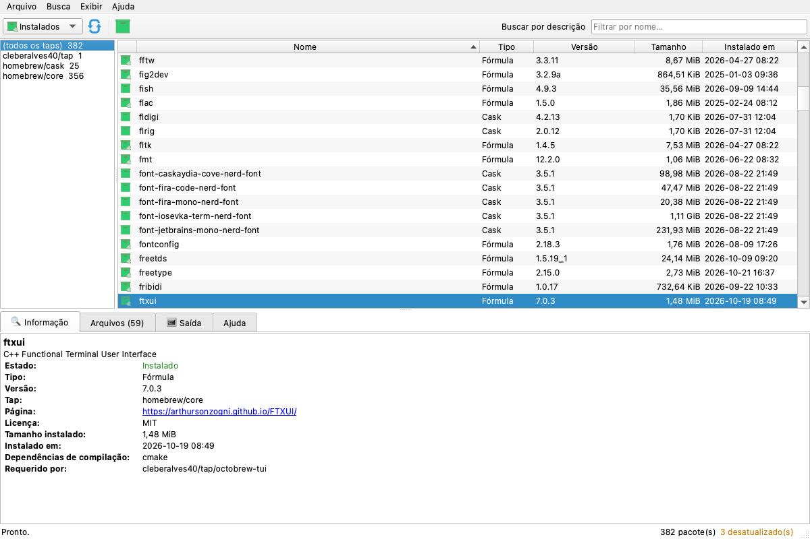
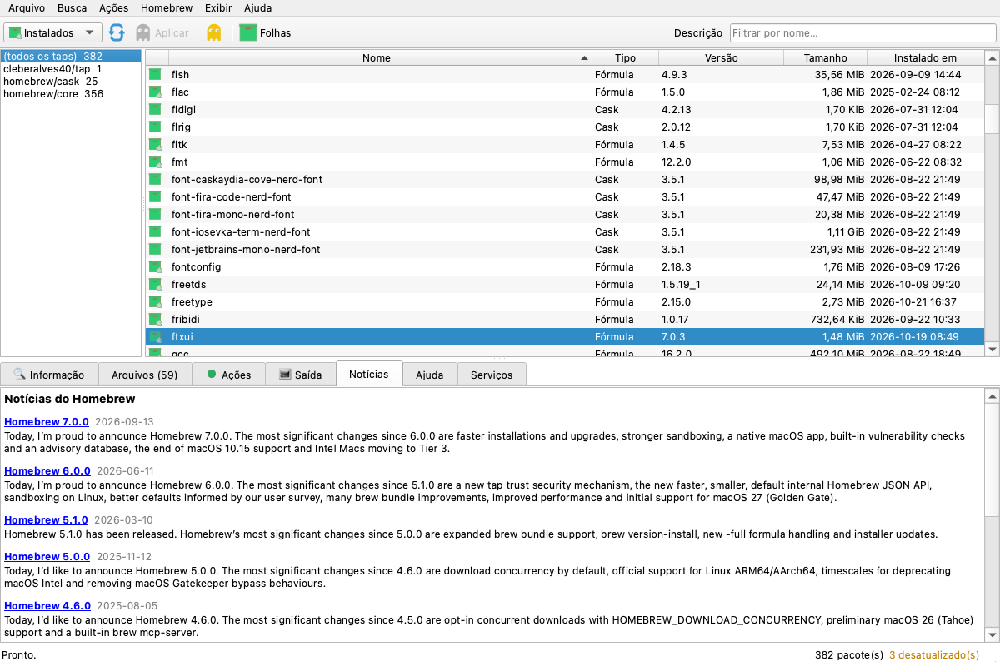
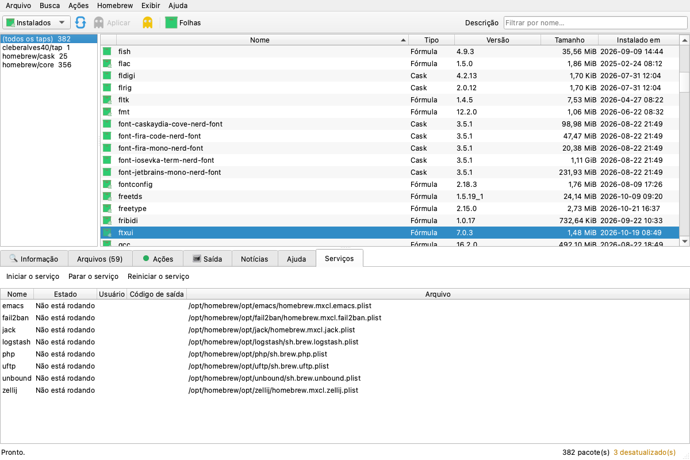

# OctoBrew

[](https://github.com/cleberalves40/octobrew/actions/workflows/build.yml)
[](LICENSE)

Interface gráfica (Qt6) para o [Homebrew](https://brew.sh), com o desenho do
[OctoPkg](https://github.com/aarnt/octopkg), a interface do `pkg(8)` nos BSDs, e o núcleo
do [octobrew-tui](https://github.com/cleberalves40/octobrew-tui), a versão de terminal.



## Estado

**v1.0.0** (as Fases 0 a 5 do [roadmap](docs/ROADMAP.md)). O programa:

- lista as fórmulas e os casks instalados e os do repositório (o cache da API do
  Homebrew, mais os taps de terceiros), com os ícones de estado do OctoPkg;
- filtra pelo tap (à esquerda, no lugar dos grupos do OctoPkg), pelo nome ou pela
  descrição, e mostra só as folhas (`brew leaves`);
- mostra os detalhes do pacote selecionado (com os *caveats*), os arquivos e o espaço em
  disco, medido em segundo plano;
- ordena por qualquer coluna, lembra a ordem, o modo de busca e o tamanho da janela;
- marca pacotes para instalar (**+**) e remover (**-**), mostra a prévia no diálogo de
  transação do OctoPkg e a executa (**⌥M**), com um snapshot em Brewfile antes;
- instala as atualizações (**⌘U**), atualiza o Homebrew (**⌘K**), limpa o cache, remove
  as dependências desnecessárias, fixa e libera pacotes e restaura um snapshot;
- pede a senha do sudo, para os casks com `.pkg`, por um diálogo próprio
  (`octobrew-askpass`).

- mostra as notícias do blog do Homebrew (aba **Notícias**, ⌥5) e os serviços (aba
  **Serviços**, ⌥7), que inicia, para e reinicia;
- adiciona e remove taps (com a confiança do brew 6+), roda o `brew doctor`, e exporta e
  instala de Brewfiles com o diálogo de arquivo nativo, no menu **Homebrew**.

- avisa das atualizações pelo **notificador** da barra de menus (o polvo do Octopi, como o
  octopi-notifier), que pode iniciar com o sistema, e pela contagem no ícone do Dock;
- tem as **Preferências** (⌘,): o idioma, a aparência (clara, escura ou a do sistema) e o
  notificador.

Veja o [CHANGELOG](CHANGELOG.md).

## Instalação

```sh
brew install cleberalves40/tap/octobrew
ln -sf "$(brew --prefix)/opt/octobrew/OctoBrew.app" /Applications/OctoBrew.app   # opcional
```

O nome completo adiciona o tap e, no brew 6+, já confia nele. O brew compila a partir do
código, com o CMake, o Ninja e o `qtbase`; o `brew upgrade` traz as versões novas. O
comando `octobrew` abre o aplicativo pelo terminal. Sem cask por enquanto: um cask
precisaria da notarização da Apple (veja o [RELEASING](docs/RELEASING.md)).

## O notificador

O `octobrew-notifier` mora dentro do `OctoBrew.app` e vive só na barra de menus (fora do
Dock e do ⌘⇥). Verifica ao abrir e de tempos em tempos (6 h por padrão), com o
`brew update` antes, como o octopi-notifier, e mostra o polvo verde (em dia), amarelo (há
atualizações) ou vermelho (o brew falhou). O menu tem os pacotes desatualizados,
**Instalar as atualizações** (que abre o OctoBrew direto no diálogo do upgrade), **Abrir o
OctoBrew** e **Procurar atualizações agora**.

Em Preferências → **Iniciar o notificador ao entrar no sistema**, o OctoBrew grava um
LaunchAgent em `~/Library/LaunchAgents/io.github.cleberalves40.octobrew.notifier.plist` (e
o tira ao desmarcar). Para rodá-lo à mão: `OctoBrew.app/Contents/MacOS/octobrew-notifier`.

| Notícias | Serviços |
|:---:|:---:|
|  |  |

## Transações

As mesmas do octobrew-tui, com o diálogo de transação do OctoPkg:

- **Prévia:** `brew install --dry-run` e `brew upgrade --dry-run`; na remoção, os
  instalados que dependem dos marcados, direta ou indiretamente, que o brew exige que
  saiam juntos. O diálogo vira **Aviso**, com o "Não" como padrão, e um dependente
  fixado impede a remoção.
- **Snapshot:** a opção de um `brew bundle dump` em `~/.config/octobrew/snapshots/`, o Boot
  Environment do OctoPkg no Homebrew. Se ele falhar, nada muda.
- **Sem surpresas:** sem auto-update, sem a pergunta do brew 7 e sem o autoremove
  automático do `brew uninstall`.
- **sudo:** o brew roda como o usuário. Os casks com instaladores `.pkg` pedem o sudo, que
  pede a senha pelo `octobrew-askpass` (`SUDO_ASKPASS`, `sudo -A`). A senha vai direto ao
  sudo e não é guardada.

## Compilação (a partir do código)

```sh
brew install qtbase cmake ninja
cmake -B build -S . -G Ninja -DCMAKE_BUILD_TYPE=Release -DCMAKE_PREFIX_PATH="$(brew --prefix)"
cmake --build build
open build/OctoBrew.app
```

Opções: `--remote` (começa na visão Repositório), `--lang=en_US|pt_BR|es_ES`,
`--config=ARQUIVO`, `--brew=EXECUTÁVEL`, `--version`. As preferências ficam em
`~/.config/octobrew/config`, separadas das do octobrew-tui.

Para um `OctoBrew.app` autocontido, com o Qt dentro e uma assinatura *ad hoc*:
`sh ci/bundle.sh build` (o aplicativo fica em `build/deploy/`).

No Linux, com o Qt 6.4 ou mais novo (`apt install qt6-base-dev`), o mesmo CMake gera o
executável `octobrew`.

## Teclado

Os atalhos do OctoPkg. Numa GUI, o ⌘ chega ao programa: o Qt mostra o Ctrl como ⌘ no
macOS.

| Tecla (macOS) | Linux | Ação |
|:---|:---|:---|
| <kbd>F5</kbd> / <kbd>⌘R</kbd> | F5 / Ctrl+R | Atualizar a lista |
| <kbd>⌘I</kbd> | Ctrl+I | Alternar entre os instalados e o repositório |
| <kbd>⌘L</kbd> | Ctrl+L | Buscar um pacote na lista |
| <kbd>F7</kbd> | F7 | Buscar por descrição |
| <kbd>⇧⌘L</kbd> | Shift+Ctrl+L | Só as folhas |
| <kbd>+</kbd> / <kbd>-</kbd> | + / - (ou Insert / Delete) | Marcar para instalar / remover (com o foco na lista) |
| <kbd>⌥M</kbd> | Ctrl+M | Aplicar: prévia, confirmação e a transação |
| <kbd>⌘E</kbd> | Ctrl+E | Desfazer as marcas |
| <kbd>⌘U</kbd> / <kbd>⌘K</kbd> | Ctrl+U / Ctrl+K | Instalar as atualizações / atualizar o Homebrew |
| <kbd>⌥1</kbd>…<kbd>⌥6</kbd> | Alt+1…Alt+6 | Abas Informação, Arquivos, Ações, Saída, Notícias e Ajuda, com os números do OctoPkg |
| <kbd>⌥7</kbd> | Alt+7 | Aba Serviços (`brew services`) |
| <kbd>⌘G</kbd> | Ctrl+G | Buscar as últimas notícias do Homebrew |
| <kbd>F1</kbd> | F1 | Ajuda |
| <kbd>⌘,</kbd> | — | Preferências |
| <kbd>⌘M</kbd> | — | Minimizar (menu Janela) |
| <kbd>⌘Q</kbd> | Ctrl+Q | Sair |

## Arquitetura

| Camada | Local | Responsabilidade |
|:---|:---|:---|
| Núcleo | `tui/src/core/`, `tui/src/model/` | O octobrew-tui, num [git subtree](docs/RELEASING.md): o brew sem shell, o JSON, o cache da API, os estados, os tamanhos, i18n e o filtro e a ordem da lista. C++17 puro, sem Qt |
| Interface | `src/gui/` | Qt6 Widgets: a janela do OctoPkg (`mainwindow`), o diálogo de transação (`transactiondialog`), o diálogo de senha do sudo (`askpass`, e o executável `octobrew-askpass`), a tabela sobre o vetor de pacotes do núcleo (`packagemodel`, sem um item por célula: são ~17 mil pacotes), as páginas das abas em HTML (`pages`) e o catálogo de textos da GUI, que cai no do núcleo (`texts`) |
| Recursos | `resources/` | Os ícones do OctoPkg (Octopi), © Alexandre Albuquerque Arnt, e o `OctoBrew.icns` |

O trabalho com o brew roda fora da interface (`QtConcurrent`), com o núcleo síncrono do
octobrew-tui; os testes rodam o mesmo trabalho na hora (`synchronous`).

## Testes

```sh
cmake -B build -S . -DOCTOBREW_BUILD_TESTS=ON && cmake --build build
QT_QPA_PLATFORM=offscreen ctest --test-dir build
OCTOBREW_TEST_BREW=$(command -v brew) OCTOBREW_SCREENSHOT=/tmp/octobrew.png ./build/tst_integration
```

- `tst_model`: a tabela (filtro, ordem, tap, folhas, ícones, células), as páginas das abas
  e o catálogo.
- `tst_mainwindow`: a janela sem tela, com o brew falso e as amostras do brew 7 dos testes
  do octobrew-tui: listagem, repositório, taps, busca, folhas, detalhes, arquivos, erros,
  Ajuda e preferências.
- `tst_transactions`: as marcas, a aba Ações, os diálogos, as operações na ordem e com o
  ambiente certos, o snapshot, as falhas e o diálogo de senha.
- `tst_homebrew`: as abas Notícias e Serviços, os serviços, os taps, o doctor e os
  Brewfiles.
- `tst_macos`: o notificador (o resumo, o menu, a verificação e o LaunchAgent), as
  Preferências, a contagem do Dock e o `--upgrade`, com o `HOME` num diretório temporário.
- `tests/check-translations.py`: todo texto da GUI com o português e o espanhol.
- `tst_integration`: a janela contra o Homebrew real, só lendo, com uma captura da tela.

O CI roda no macOS (o Qt do Homebrew, a integração e o bundle aberto de verdade) e no
Ubuntu (o Qt 6.4, também com ASan e UBSan).

## Licença

[GPL-2.0-or-later](LICENSE). O desenho e os ícones vêm do OctoPkg, © Alexandre
Albuquerque Arnt; o núcleo, do octobrew-tui.
